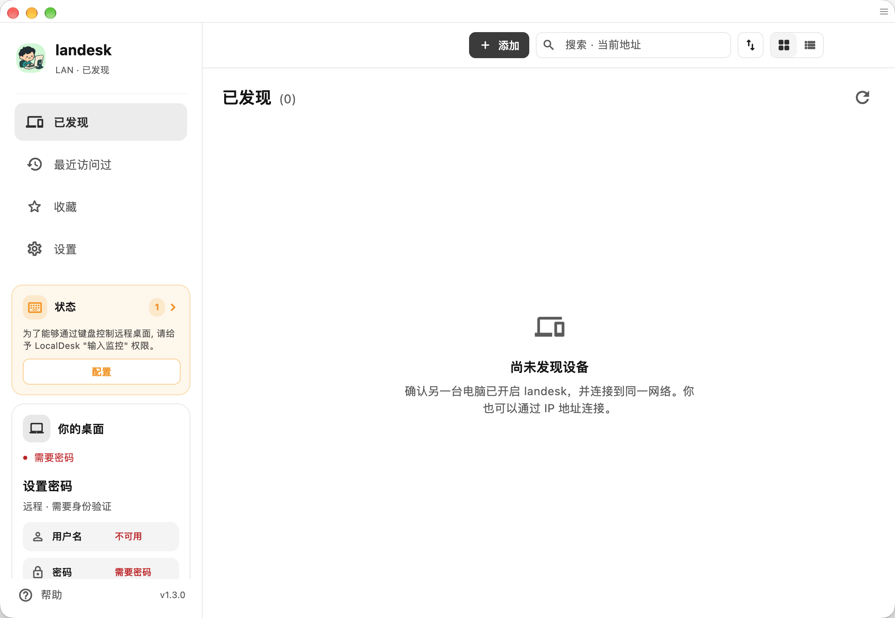
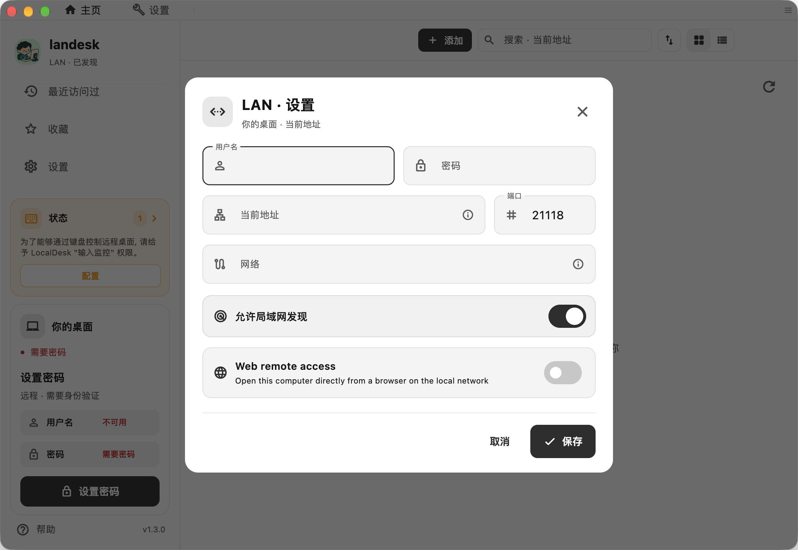
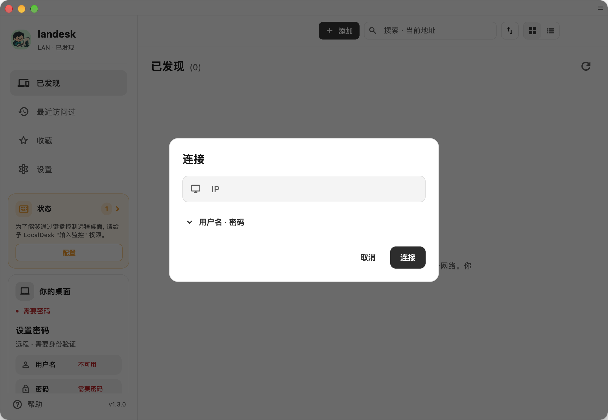

<p align="center">
  
</p>

# landesk

Derived from [SubnetDesk](https://github.com/zibo-chen/SubnetDesk) and [RustDesk](https://github.com/rustdesk/rustdesk), under AGPL-3.0.
This development branch includes iPad virtual keys. See [migration and validation](docs/localdesk-migration.md).

Only private IP endpoints are accepted. Both ends must use the LAN protocol; stock RustDesk peers are not compatible. Online update and plugin features are excluded from landesk builds.

<p align="center">
  <strong>A LAN-first remote desktop for fast, private, direct connections.</strong>
</p>

<p align="center">
  A fork of <a href="https://github.com/zibo-chen/SubnetDesk">SubnetDesk</a>, built on <a href="https://github.com/rustdesk/rustdesk">RustDesk</a>, independently maintained built for LANs, routed private networks, and VPNs.
</p>

<p align="center">
  <a href="https://github.com/quanru/landesk/releases/latest"></a>
  <a href="https://github.com/quanru/landesk/releases"></a>
  <a href="https://github.com/quanru/landesk/stargazers"></a>
  <a href="https://github.com/quanru/landesk/network/members"></a>
  <a href="https://github.com/quanru/landesk/actions/workflows/localdesk-preflight.yml"></a>
  <a href="LICENCE"></a>
</p>

<p align="center">
  
  
  
  
</p>

<p align="center">
  <a href="https://landesk.lifeos.md/">Website</a> · English · <a href="README.zh-CN.md">简体中文</a>
</p>

<p align="center">
  <a href="#why-localdesk">Why landesk</a> ·
  <a href="#features">Features</a> ·
  <a href="#download">Download</a> ·
  <a href="#quick-start">Quick start</a> ·
  <a href="#build-from-source">Build</a>
</p>

<p align="center">
  
</p>

<a id="why-localdesk"></a>

The screenshots below show the real macOS 1.3.0 (99) preview in Chinese. The initial discovery list is empty until a nearby compatible peer is found.

## 💡 Why landesk

landesk focuses on one clear use case: remote control between devices that can already reach each other. It removes the public device-ID, rendezvous, relay, cloud account, proxy, and automatic public-update paths from RustDesk, replacing them with direct endpoint connections and local device discovery.

That makes it a good fit for home labs, offices, classrooms, on-site support, and private networks connected by WireGuard, Tailscale, OpenVPN, or another VPN.

| | landesk | Typical RustDesk deployment |
| --- | --- | --- |
| Connection | Direct private IP address | Device ID through rendezvous, with optional relay |
| Discovery | Automatic mDNS discovery on the LAN | Device ID or address book |
| Server dependency | No coordination server required | Public or self-hosted rendezvous/relay server |
| Best suited for | LANs, routed private networks, and VPNs | Internet and cross-NAT access |

> [!IMPORTANT]
> landesk does not provide Internet rendezvous or relay services. The two devices must be reachable through the same LAN, a routed private network, or a VPN.

<a id="features"></a>

## ✨ Features

| | Capability | Details |
| --- | --- | --- |
| 🔎 | Local discovery | Find nearby devices automatically over mDNS. |
| ⚡ | Direct connections | Connect by private IP address using a configurable TCP port. |
| 🔐 | Access protection | Authenticate with a username and password; passwords are stored as Argon2id hashes. |
| 🛡️ | Device verification | Verify and remember endpoint fingerprints before trusting a device. |
| 🌐 | Network allowlist | Restrict incoming connections to selected CIDR networks. |
| ⭐ | Fast reconnection | Keep recent devices, favorites, and stable device identities. |
| 🖥️ | RustDesk experience | Retain remote control, clipboard, audio, and file-transfer capabilities without a public coordination server. |

<a id="download"></a>

## 📦 Download

[Download macOS Apple Silicon preview (.zip)](https://www.feishu.cn/file/B3xNbSIJboMZIExIwFvcuM1onBe) · [GitHub backup](https://github.com/quanru/landesk/releases/download/v1.3.0-preview.20261030/landesk-1.3.0-99-macos-arm64.zip) · [Release notes and SHA-256](https://github.com/quanru/landesk/releases/tag/v1.3.0-preview.20261030)

This is a development preview, signed with an Apple Development certificate, **not notarized**. Gatekeeper may block it on another Mac; it is not a Developer ID distribution. The archive contains `LanDesk.app`; the existing bundle identity is retained. For a new installation, extract it and copy it to Applications. Existing `LocalDesk.app` installations must follow the [name migration steps](docs/validation/macos-name-migration-2026-10-29.md) to update background service paths.

All currently published desktop and Android packages are listed below. They are previews / Nightly builds, not stable releases; some filenames still use the previous LocalDesk name. iPhone and iPad are controllers only. The [public TestFlight link](https://testflight.apple.com/join/gFHTx8Xy) is enabled; installation requires Apple external beta approval, which is pending.

| Platform | Primary download |
| --- | --- |
| macOS Apple Silicon · 1.3.0 (99) | [下载 / Download](https://www.feishu.cn/file/B3xNbSIJboMZIExIwFvcuM1onBe) · [GitHub](https://github.com/quanru/landesk/releases/download/v1.3.0-preview.20261030/landesk-1.3.0-99-macos-arm64.zip) |
| Windows x64 · Nightly | [下载 / Download](https://www.feishu.cn/file/RqVqb6mewo2pFvxbBXXcvhi1nIe) · [GitHub](https://github.com/quanru/landesk/releases/download/nightly/localdesk-1.3.0-x86_64.exe) |
| Linux x64 DEB · Nightly | [下载 / Download](https://www.feishu.cn/file/Ek28bEqTEoPWGmxDRN5cdrhenPe) · [GitHub](https://github.com/quanru/landesk/releases/download/nightly/localdesk-1.3.0-x86_64.deb) |
| Android ARM64 · Nightly | [下载 / Download](https://www.feishu.cn/file/X8Pnbi6jOoh0jZxYq5RcQZ21nYe) · [GitHub](https://github.com/quanru/landesk/releases/download/nightly/localdesk-1.3.0-aarch64-signed.apk) |
| iPhone / iPad | [TestFlight](https://testflight.apple.com/join/gFHTx8Xy) — not open; external review required |

<details>
<summary>Other architectures and installation formats (GitHub backups)</summary>

| Platform | Public downloads |
| --- | --- |
| macOS | [landesk-1.3.0-99-macos-arm64.zip](https://github.com/quanru/landesk/releases/download/v1.3.0-preview.20261030/landesk-1.3.0-99-macos-arm64.zip) · [localdesk-1.3.0-aarch64.dmg](https://github.com/quanru/landesk/releases/download/nightly/localdesk-1.3.0-aarch64.dmg) · [localdesk-1.3.0-x86_64.dmg](https://github.com/quanru/landesk/releases/download/nightly/localdesk-1.3.0-x86_64.dmg) |
| Windows | [localdesk-1.3.0-aarch64.exe](https://github.com/quanru/landesk/releases/download/nightly/localdesk-1.3.0-aarch64.exe) · [localdesk-1.3.0-aarch64.msi](https://github.com/quanru/landesk/releases/download/nightly/localdesk-1.3.0-aarch64.msi) · [localdesk-1.3.0-x86_64.exe](https://github.com/quanru/landesk/releases/download/nightly/localdesk-1.3.0-x86_64.exe) · [localdesk-1.3.0-x86_64.msi](https://github.com/quanru/landesk/releases/download/nightly/localdesk-1.3.0-x86_64.msi) |
| Linux | [localdesk-1.3.0-0-x86_64.pkg.tar.zst](https://github.com/quanru/landesk/releases/download/nightly/localdesk-1.3.0-0-x86_64.pkg.tar.zst) · [localdesk-1.3.0-0.aarch64-suse.rpm](https://github.com/quanru/landesk/releases/download/nightly/localdesk-1.3.0-0.aarch64-suse.rpm) · [localdesk-1.3.0-0.aarch64.rpm](https://github.com/quanru/landesk/releases/download/nightly/localdesk-1.3.0-0.aarch64.rpm) · [localdesk-1.3.0-0.x86_64-suse.rpm](https://github.com/quanru/landesk/releases/download/nightly/localdesk-1.3.0-0.x86_64-suse.rpm) · [localdesk-1.3.0-0.x86_64.rpm](https://github.com/quanru/landesk/releases/download/nightly/localdesk-1.3.0-0.x86_64.rpm) · [localdesk-1.3.0-aarch64.AppImage](https://github.com/quanru/landesk/releases/download/nightly/localdesk-1.3.0-aarch64.AppImage) · [localdesk-1.3.0-aarch64.deb](https://github.com/quanru/landesk/releases/download/nightly/localdesk-1.3.0-aarch64.deb) · [localdesk-1.3.0-aarch64.flatpak](https://github.com/quanru/landesk/releases/download/nightly/localdesk-1.3.0-aarch64.flatpak) · [localdesk-1.3.0-x86_64.AppImage](https://github.com/quanru/landesk/releases/download/nightly/localdesk-1.3.0-x86_64.AppImage) · [localdesk-1.3.0-x86_64.deb](https://github.com/quanru/landesk/releases/download/nightly/localdesk-1.3.0-x86_64.deb) · [localdesk-1.3.0-x86_64.flatpak](https://github.com/quanru/landesk/releases/download/nightly/localdesk-1.3.0-x86_64.flatpak) · [localdesk-unattended-wayland-1.3.0-x86_64.deb](https://github.com/quanru/landesk/releases/download/nightly/localdesk-unattended-wayland-1.3.0-x86_64.deb) |
| Android | [localdesk-1.3.0-aarch64-signed.apk](https://github.com/quanru/landesk/releases/download/nightly/localdesk-1.3.0-aarch64-signed.apk) · [localdesk-1.3.0-armv7-signed.apk](https://github.com/quanru/landesk/releases/download/nightly/localdesk-1.3.0-armv7-signed.apk) · [localdesk-1.3.0-universal-signed.apk](https://github.com/quanru/landesk/releases/download/nightly/localdesk-1.3.0-universal-signed.apk) · [localdesk-1.3.0-x86_64-signed.apk](https://github.com/quanru/landesk/releases/download/nightly/localdesk-1.3.0-x86_64-signed.apk) |
| iPhone / iPad | [TestFlight](https://testflight.apple.com/join/gFHTx8Xy) — not open; external review required |

</details>

<a id="quick-start"></a>

## 🚀 Quick start

1. Install and open landesk on both devices.
2. On the controlled device, open **LAN settings** from the local desktop card, set a username and password, and enable LAN discovery. The default port is `21118`.
3. On the controller, select a discovered device or enter `IP:port` manually.
4. Verify the device fingerprint on first connection, then connect.

<p align="center">
  
</p>

### Network checklist

- Both devices can route to each other.
- TCP port `21118` (or your configured port) is allowed by the host firewall.
- mDNS is available when automatic discovery is needed; direct address entry still works without it.
- The controlled device's CIDR allowlist includes the controller's network.
- On Linux, see [host readiness notes](docs/linux-host-readiness.md) for SELinux, Wayland, and login-screen guidance.

### Direct private-IP connection

Use **Add** to open the connection dialog. Enter a private IP address and expand the username/password fields when needed; check the fingerprint before trusting a new peer.

<p align="center">
  
</p>

## 🔒 Security model

- Traffic stays on the network path between your devices; landesk does not require a public coordination service.
- Passwords are persisted as Argon2id hashes rather than plaintext.
- Device fingerprints provide trust-on-first-use verification and help detect an unexpected endpoint identity change.
- CIDR allowlists let the controlled device limit which source networks may connect.

As with any remote-control software, expose the listening port only to trusted networks, use a strong unique password, and verify fingerprints through a separate trusted channel when possible.

See the [landesk Privacy Policy](PRIVACY.md) for session data, local storage, update requests, and deletion controls.

<a id="build-from-source"></a>

## 🛠️ Build from source

Clone the repository with its submodules, then run the Flutter desktop build:

```bash
git clone --recurse-submodules https://github.com/quanru/landesk.git
cd landesk
./build.py --flutter --hwcodec
```

The build requires Rust, Flutter, and platform-specific native dependencies. The [native package workflow](.github/workflows/flutter-build.yml) is the source of truth for pinned tool versions, target architectures, and packaging steps.

The pinned `libs/hbb_common` submodule uses the LanDesk-maintained fork for private-IP validation and LAN configuration. See [why this fork is retained](docs/landesk-common.md).

## 🤝 Contributing

Bug reports, feature ideas, and pull requests are welcome. Before opening a change, check the existing [issues](https://github.com/quanru/landesk/issues) and keep changes focused on the LAN/VPN-first product scope.

## Support

Report bugs and request features in [GitHub Issues](https://github.com/quanru/landesk/issues). Do not include credentials or private session content.

## 🙏 Credits and license

LanDesk is a fork of [SubnetDesk](https://github.com/zibo-chen/SubnetDesk) by [zibo-chen](https://github.com/zibo-chen), which is based on [RustDesk](https://github.com/rustdesk/rustdesk). Thank you to both upstream projects and all their contributors for the remote desktop foundations and LAN-first work.

LanDesk is independently maintained by [quanru](https://github.com/quanru) and contributors. It is not an official release of either upstream project. Existing copyright notices, [NOTICE](NOTICE), and dependency licenses remain applicable; AGPL-3.0 attribution is retained.

Licensed under the [GNU Affero General Public License v3.0](LICENCE). Use remote-control software only on systems you own or are authorized to administer.

## License and source / 开源许可与源码

See [NOTICE](NOTICE), [AGPL v3](LICENCE), [version-specific sources](docs/licensing/releases.md), and [build/dependency coverage](docs/licensing/README.md).
