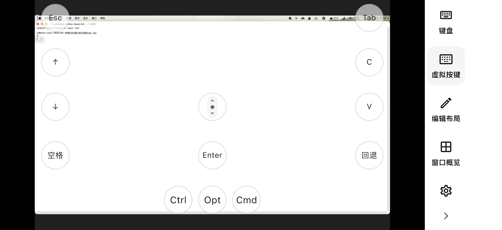
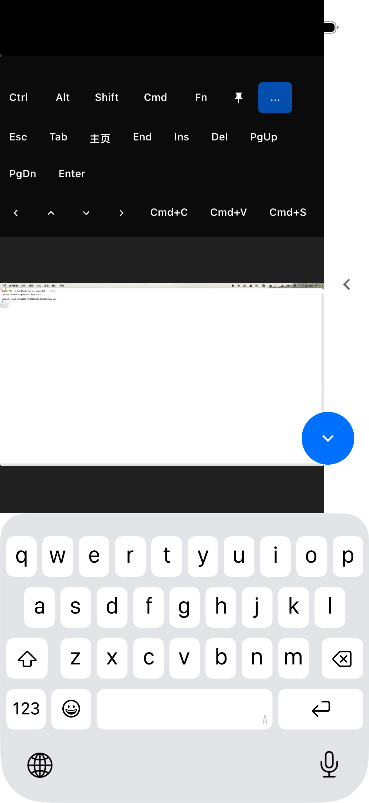

# LanDesk

基于 [RustDesk](https://github.com/rustdesk/rustdesk) 修改的开源局域网远程工具，
换了一套现代主题，加入了可编辑的虚拟按键。跨网络使用时，建议搭配 Tailscale。

[官网](https://landesk.lifeos.md/zh/) · [English](README.md) · [许可证](LICENCE)

## 主线迁移状态

`main` 已切换到固定的官方 RustDesk 基线，此前基于 SubnetDesk 的版本保留在 `legacy`，
**原生迁移版以预览版发布，尚非稳定版，也未完成所有功能验证**。具体进展与验证结果见
[迁移台账](docs/validation/native-migration-progress-2026-11-04.md)。

- 使用私网 IP 地址直连，可指定端口，默认端口为 `21118`。局域网发现返回直连地址。
- 保留上游密码认证、被控端批准和会话权限控制，知道 IP 不等于获得控制权限。
- 原生 IP 连接不额外提供应用层传输加密，需要加密时使用 Tailscale 或 VPN。
  普通局域网连接不会自动获得加密保护。
- 产品入口禁用公网设备 ID、会合、打洞、中继、云账号和在线自动更新。
- 远控需安装原生客户端；已移除内置浏览器网关和 Web 客户端。
- 虚拟按键支持组合键、按住与释放、编辑布局；主题和输入控件由各 Flutter 端共用。

两端都需要升级到新版。不保留旧 SubnetDesk 协议，不转换旧密码或配置。
旧配置文件留在原处，新版使用独立配置位置。与其他 RustDesk 版本的互通需要实测，
本分支暂不作承诺。

## 下载与截图

通过[官网](https://landesk.lifeos.md/zh/#download)下载 **1.5.1（101）原生预览版**，飞书为主下载、GitHub 为备用。
[发布说明与校验值](https://github.com/quanru/landesk/releases/tag/v1.5.1-preview.20261113)覆盖 macOS、Windows、Linux 和 Android，两端都需升级。
iOS build 101 已通过外部审核，可加入 [TestFlight 公开测试](https://testflight.apple.com/join/gFHTx8Xy)。实际检查项与限制见[发布验证记录](docs/validation/release-2026-11-13.md)。

2026-11-05 实拍：iOS 模拟器通过新版原生协议连接真实 Mac。虚拟 C、Enter、V 按键已到达 TextEdit；系统键盘文字输入、横竖屏布局及键盘展开／收起已检查。这是开发版截图，不是 iOS 真机验证；发行产物的真机检查另见发布验证记录。

## 源码与构建

主应用和 common 库的固定提交见[基线记录](tools/migration/native-baseline.json)。
使用 `git submodule update --init --recursive` 初始化对应子模块。

迁移验证环境为 Rust 1.82、Flutter 3.44.1 和 `flutter_rust_bridge_codegen` 1.80.1。
生成的桥接文件必须与 `src/flutter_ffi.rs` 一致。

[迁移方案](docs/design/rustdesk-migration-plan-2026-11-04.md)记录功能范围与验收要求。
构建或单测通过不代表各端远控已经可用，请以台账中的实际验证范围为准。

## 致谢与许可

LanDesk 基于 [RustDesk](https://github.com/rustdesk/rustdesk)，使用 **AGPL-3.0** 许可证。
感谢 RustDesk 及其贡献者提供远程桌面、音视频、文件传输和认证基础。
LanDesk 的产品主题、虚拟按键和集成改动在本仓库独立维护。

本项目是独立维护的 fork，不是 RustDesk 官方发行版。
组件来源见[许可文档](docs/licensing/README.md)，源码中的上游版权与许可声明均保留。

## 同步上游

固定基线、Git 祖先关系、差异检查与验证步骤见[上游同步约定](docs/upstream-sync.md)。
